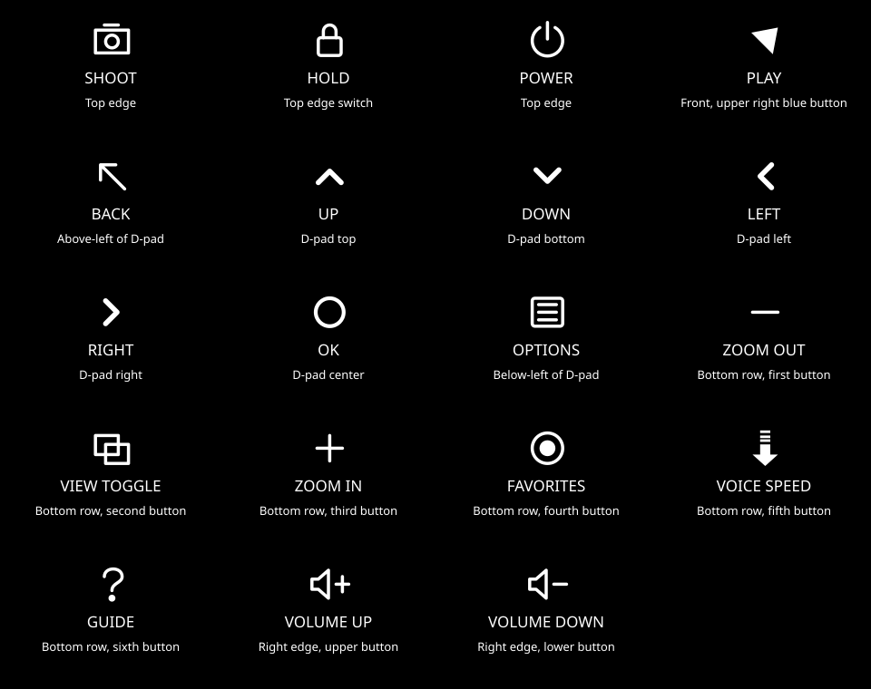

# Reader buttons and icons

App-facing usage and required glyph shapes are defined in the
[app development guide](../../APP_DEVELOPMENT.md#buttons-and-their-icons).
Some SVGs/generated symbol descriptions below still use earlier approximations;
the guide records the pending centralized artwork corrections. Keep using the
shared icon names rather than drawing per-app replacements.

The canonical map is [buttons.json](buttons.json). Run `python3 antix/input/generate.py`
after editing it; `--check` checks the generated C header, udev hwdb, table and visual reference. Builds
check for drift. The model-specific hwdb changes only the Reader's built-in AT
keyboard, not attached USB keyboards. Application-facing `READER_*` numeric IDs
remain stable. Historical owner measurements are preserved in [buttons.md](../../buttons.md).

Xorg/libinput owns input delivery and focus. Apps receive ordinary X11/Qt key
press, release and repeat events. Screen translates them into semantic IDs;
apps do not open evdev devices or manage framebuffer ownership. Other toolkits
can use the XKB symbols directly. A normal keyboard can navigate with arrows,
Enter, Escape, Menu, F1 and keypad +/−. Space is also a Play shortcut in Screen;
keypad Enter, dedicated Back and Help keys are accepted.

Power belongs to elogind; global volume belongs to triggerhappy/ALSA. Hold belongs
to the session service, which disables the built-in keyboard through standard
`xinput` while locked. Its raw Linux listener can still see the unlock event and
Power remains available to elogind. Apps must not take exclusive evdev grabs.
Qt's synthetic releases during focus/suspend transitions never change Hold.
The switch reports pressed = unlocked, released = locked; boot position before
its first report is not proven, so the session initially allows input. There
is no invented physical-state query or persistent guess across power cycles.

Back, Help, Options and Zoom use normal keyboard assignments. Other keys retain
their standard Linux camera, media, bookmark, display and system meanings.
Keypad +/− avoids X11's 255 keycode ceiling; Linux Zoom codes 418/419 cannot be
used directly. A physical symbol identifies a button, not a mandatory app action:
the record-like button is named Favorites for compatibility and typically returns
Home. It is not an instruction to record audio in every app.

The named SVG files under [icons](icons) are installed in
`/usr/share/icons/hicolor/scalable/actions`. They are freedesktop icon-theme
assets, available through normal theme lookup, e.g.
`QIcon::fromTheme("reread-button-back")`. `reader_button_icon_name(READER_BACK)`
returns that name; Screen uses these same assets for hints. They have white
strokes on transparency for ReRead's high-contrast control hints. Apps may tint
them for other backgrounds. Application icons remain independent `.desktop`
`Icon=` entries; a button icon identifies the physical control next to an action.

The symbols are vector redrawings of the owner-described controls, not extracted
vendor artwork. Power, Hold and volume use conventional symbols where the
historical notes identify position/function rather than an exact printed glyph.

## Physical reference

Front: blue Play is above-right; Back is above-left of the D-pad and Options
below-left. The D-pad has four directions and OK in its center. The bottom row
from left to right is Zoom −, View, Zoom +, Favorites, Voice Speed, Guide.
Shoot, Hold and Power are on the top edge; Volume +/− are on the right edge.

<!-- generated table -->

| Button | Location / symbol | Linux code | XKB symbol | Icon name | Default role |
| --- | --- | --- | --- | --- | --- |
| `SHOOT` | Top edge; Camera outline | `CAMERA` (212) | `XF86WebCam` | `reread-button-shoot` | Capture or open Camera |
| `HOLD` | Top edge switch; Padlock | `SCREENLOCK` (152) | `XF86ScreenSaver` | `reread-button-hold` | Lock ordinary input; pressed means unlocked |
| `POWER` | Top edge; Power | `POWER` (116) | `XF86PowerOff` | `reread-button-power` | Sleep; hardware long hold forces off |
| `PLAY` | Front, upper right blue button; Right arrow | `PLAYPAUSE` (164) | `XF86AudioPlay` | `reread-button-play` | Play/pause or primary app action |
| `BACK` | Above-left of D-pad; Diagonal return arrow | `ESC` (1) | `Escape` | `reread-button-back` | Back; close at app root |
| `UP` | D-pad top; Up arrow | `UP` (103) | `Up` | `reread-button-up` | Move up |
| `DOWN` | D-pad bottom; Down arrow | `DOWN` (108) | `Down` | `reread-button-down` | Move down |
| `LEFT` | D-pad left; Left arrow | `LEFT` (105) | `Left` | `reread-button-left` | Move left or decrease |
| `RIGHT` | D-pad right; Right arrow | `RIGHT` (106) | `Right` | `reread-button-right` | Move right or increase |
| `OK` | D-pad center; Ring and dot | `ENTER` (28) | `Return` | `reread-button-ok` | Activate selection |
| `OPTIONS` | Below-left of D-pad; Menu lines | `MENU` (139) | `Menu` | `reread-button-options` | Context menu or settings |
| `ZOOM_OUT` | Bottom row, first button; Minus | `KPMINUS` (74) | `KP_Subtract` | `reread-button-zoom-out` | Zoom out or decrease |
| `VIEW_TOGGLE` | Bottom row, second button; Overlapping rectangles | `SWITCHVIDEOMODE` (227) | `XF86Display` | `reread-button-view-toggle` | Change view |
| `ZOOM_IN` | Bottom row, third button; Plus | `KPPLUS` (78) | `KP_Add` | `reread-button-zoom-in` | Zoom in or increase |
| `FAVORITES` | Bottom row, fourth button; Record-like circle | `BOOKMARKS` (156) | `XF86Favorites` | `reread-button-favorites` | Return Home; app may close |
| `VOICE_SPEED` | Bottom row, fifth button; Down arrow | `FASTFORWARD` (208) | `XF86AudioForward` | `reread-button-voice-speed` | App speed or alternate action |
| `GUIDE` | Bottom row, sixth button; Question mark | `F1` (59) | `F1` | `reread-button-guide` | Help |
| `VOLUME_UP` | Right edge, upper button; Speaker plus | `VOLUMEUP` (115) | `XF86AudioRaiseVolume` | `reread-button-volume-up` | Global volume up |
| `VOLUME_DOWN` | Right edge, lower button; Speaker minus | `VOLUMEDOWN` (114) | `XF86AudioLowerVolume` | `reread-button-volume-down` | Global volume down |

